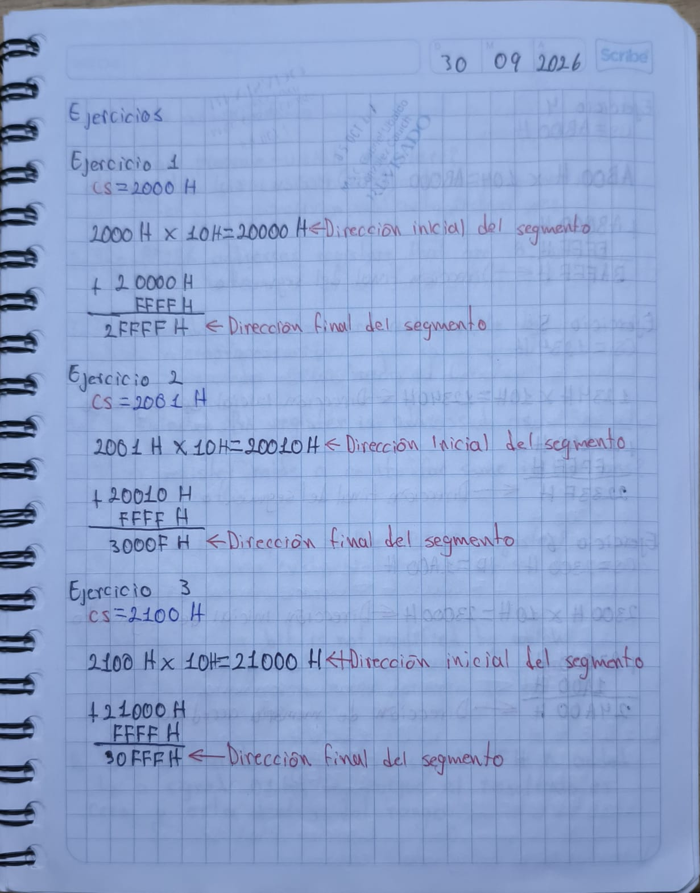
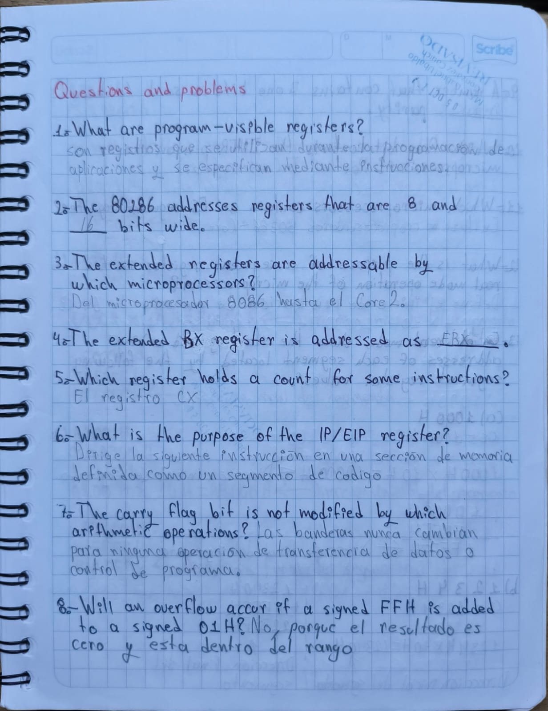
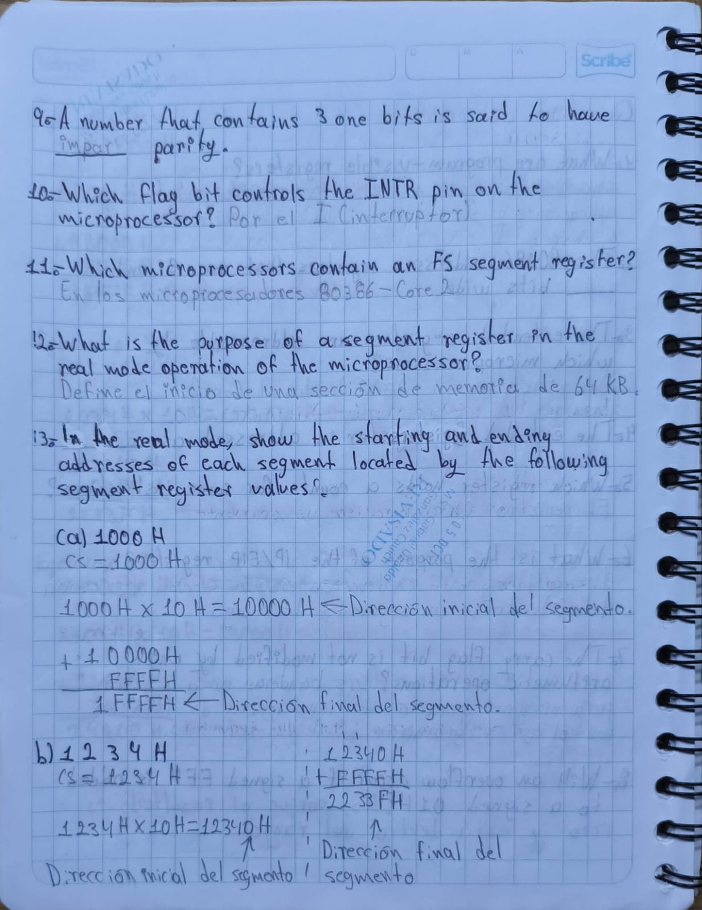
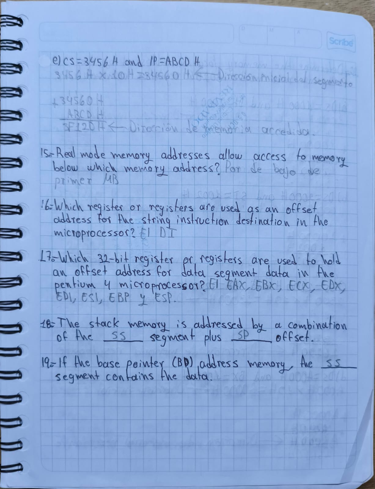
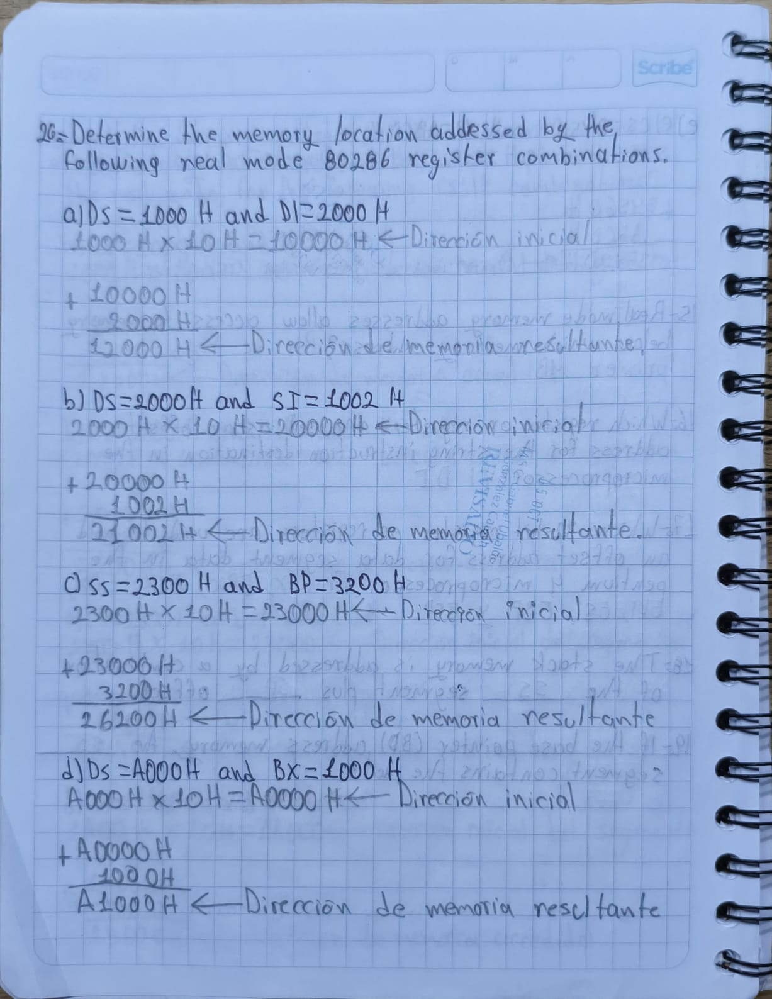
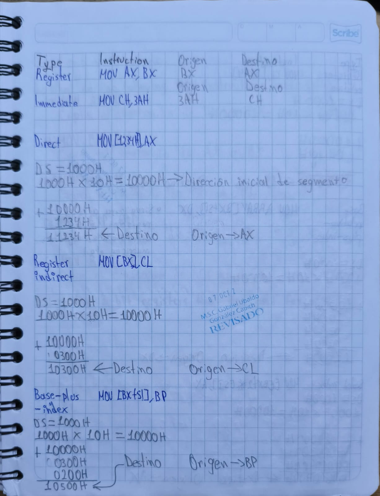
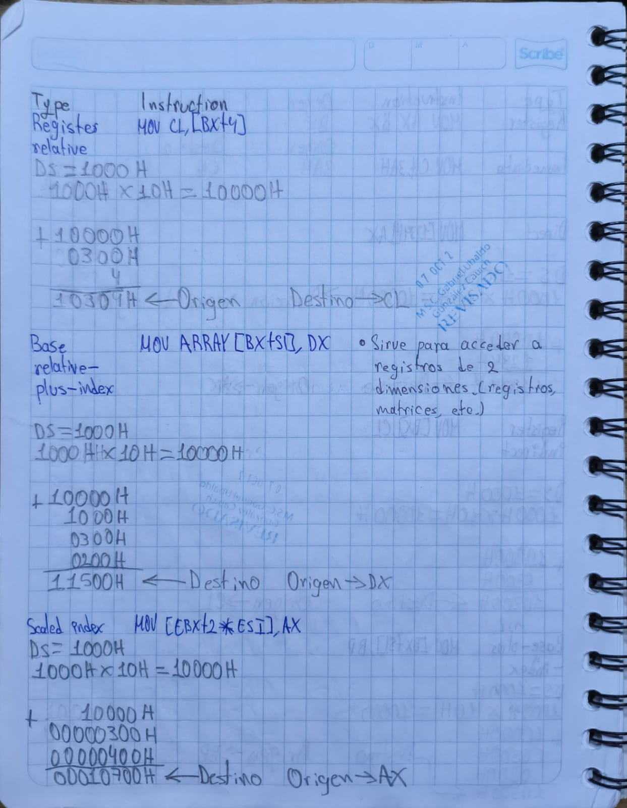
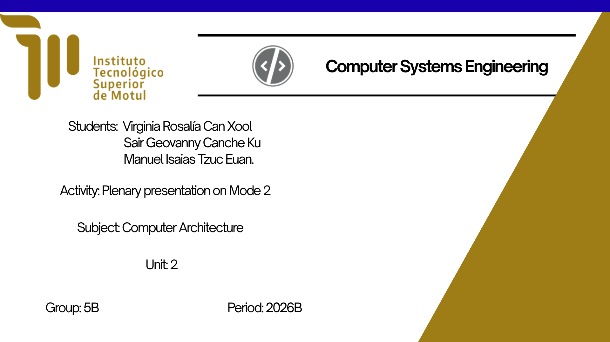
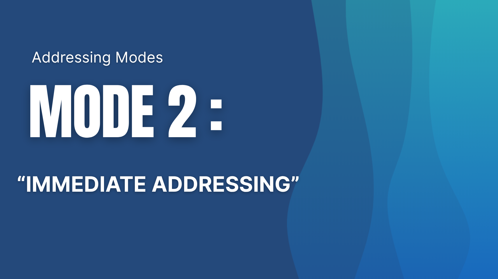
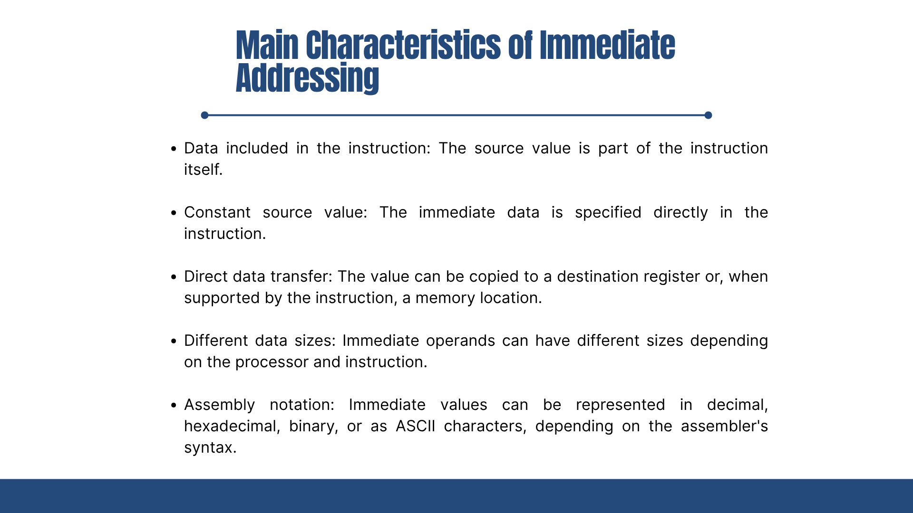

# Portafolio de Evidencias - Unidad 2

## Arquitectura de Computadoras

**Alumno:** Canche Ku Sair Geovanny  
**Semestre y grupo:** 5° B  
**Materia:** Arquitectura de Computadoras  
**Docente:** Gabriel Ubaldo González Cauich  
**Unidad:** 2  
**Actividad:** Portafolio de Evidencias: Unidad 2 
**Período:** 2026-B  

**Motul, Yucatán, México; 20 de Octubre de 2026**

---

# Introducción

Este portafolio de evidencias, basado en la segunda unidad de la asignatura Arquitectura de Computadoras, recopila todas las actividades realizadas durante la misma. Esta segunda unidad permitió profundizar en el funcionamiento interno del microprocesador y en la manera en que este trabaja con los registros y la memoria. Entre los temas principales se encuentran la arquitectura interna del microprocesador, el modelo de programación, los registros de propósito general y de propósito especial, el registro de banderas, los registros de segmento y las diferentes formas de direccionamiento de memoria.

Durante esta unidad se realizaron diferentes actividades enfocadas en comprender el funcionamiento del microprocesador y el manejo de la memoria. Se estudiaron los distintos registros del microprocesador y la función que cumple cada uno, así como el registro de banderas y el significado de sus diferentes bits. También se trabajó con el direccionamiento de memoria en modo real, donde las direcciones se forman mediante un segmento y un desplazamiento.

En conjunto, las actividades realizadas durante esta unidad permitieron ampliar los conocimientos sobre la arquitectura del microprocesador y comprender de una manera más práctica cómo se procesan los datos y cómo se accede a las diferentes ubicaciones de memoria.
---

# Objetivo del portafolio

El objetivo de este portafolio es recopilar las actividades realizadas durante la segunda unidad de forma ordenada y organizada, con el fin de poner en perspectiva la comprensión de los temas nuevos y relevantes relacionados con el funcionamiento interno del microprocesador, los registros, el direccionamiento de memoria y los diferentes modelos de memoria estudiados durante la unidad. Asimismo, busca reflejar el alcance obtenido a lo largo de las sesiones y permitir el reconocimiento de aquellos aspectos en los que es necesario seguir mejorando.

---

# Índice

1. [Ejercicios de clase](#1-ejercicios-de-clase)
2. [Questions and problems](#2-questions-and-problems)
3. [Ejercicios de clase 2](#3-ejercicios-de-clase-2)
4. [Presentación por equipos del segundo tipo de direccionamiento](#4-presentación-por-equipos-del-segundo-tipo-de-direccionamiento)
5. [Reflexión general de la unidad](#reflexión-general-de-la-unidad)
6. [Conclusión](#conclusión)

---

# 1. Ejercicios de clase

## Descripción de la actividad

Como primera actividad del parcial, se realizó este bloque de ejercicios durante la clase con ayuda del profesor. Previamente, tuvimos una introducción al tema, la cual consistió en la explicación del método "segmento más desplazamiento", el cual fue el utilizado para resolver el bloque de ejercicios, donde se usó una dirección inicial para poder acceder a la dirección final del segmento.

## Evidencia

## ¿Qué aprendí?

Con esta primera actividad, logré entender el método "segmento más desplazamiento" para poder acceder a una dirección final de segmento. Para ello, tuve que recordar temas vistos en semestres anteriores, como lo son los números hexadecimales y la suma de los mismos; de igual manera, tuve que aplicar nuevos conocimientos, como lo sería utilizar el registro CS para poder calcular la dirección inicial de memoria y, después de eso, sumarle FFFFH para calcular la dirección final del segmento.

## Errores y aspectos por mejorar

Con esta actividad pude darme cuenta de que necesitaba recordar y fortalecer mis conocimientos acerca de los números hexadecimales y sus operaciones, ya que estos son muy importantes para realizar el cálculo de las direcciones de segmentos.

---

# 2. Questions and problems

## Descripción de la actividad

Para esta segunda actividad, el profesor proporcionó un bloque de preguntas y ejercicios en conjunto con un libro para poder profundizar en la arquitectura del microprocesador, el cual tendríamos que consultar para realizar las actividades proporcionadas. Tanto las preguntas como los ejercicios estuvieron relacionados con los registros del microprocesador, en los cuales se profundizó sobre sus características y la manera en la que se utilizan. Con respecto a los ejercicios en donde se utilizó "segmento más desplazamiento", algunos fueron iguales a los hechos previamente, ya que el objetivo era calcular la dirección final del segmento; pero otros buscaban acceder a diferentes direcciones de memoria, por lo que, además del registro CS, se utilizaron otros registros.

## Evidencias

## ¿Qué aprendí?

Durante la realización de esta actividad, pude comprender de mejor manera la arquitectura interna del microprocesador, sus registros y los diferentes tamaños de estos, ya sean de 8, 16, 32 o 64 bits, y para qué sirve cada uno. Por último, aprendí a utilizar el método "segmento más desplazamiento" no solo para calcular la dirección final de un segmento, sino también para calcular una dirección de memoria en colaboración con otros registros además del CS.

## Errores y aspectos por mejorar

En primer lugar, necesito estudiar más a fondo cada uno de los registros, ya que, al ser una cantidad considerable, aún tengo problemas para identificarlos, recordar su funcionalidad y su tamaño. Por último, necesito aumentar mi dominio con los números hexadecimales, ya que soy capaz de realizar los ejercicios, pero podría hacerlos de manera más eficiente.

---

# 3. Ejercicios de clase 2

## Descripción de la actividad

Esta actividad se realizó durante la clase con ayuda del maestro, la cual consistió en realizar un bloque de ejercicios relacionados con un nuevo tema, el cual fue "modos de direccionamiento de datos". En este se vieron los distintos tipos de modos de direccionamiento de datos en conjunto con las operaciones necesarias para realizarlos y las distinciones que hay entre estas. En este se utilizó la instrucción "MOV", la cual le indica al procesador que se va a hacer una transferencia de datos, ya sea a un registro o a una dirección de memoria; este, de igual modo, ocupa el método de "segmento más desplazamiento", ya sea para calcular el origen o el destino del dato.

## Evidencia

## ¿Qué aprendí?

Aprendí a utilizar los modos de direccionamiento de memoria para transferir datos entre registros y direcciones de memoria, así como a diferenciar los distintos tipos que existen, entre estos están el inmediato, directo, registro indirecto, etc. De igual manera, aprendí que mediante la instrucción MOV se le indica al microprocesador la ejecución de una transferencia de datos empleando un direccionamiento específico. Por último, comprendí las restricciones que esto implica, como la regla sobre la compatibilidad de tamaño entre el destino y el origen.

## Errores y aspectos por mejorar

Uno de los aspectos en los que necesito mejorar es la identificación de los distintos tipos de direccionamiento de memoria, ya que, aunque algunos son sencillos de reconocer, otros poseen estructuras muy similares entre sí que pueden llevar a confusiones. Asimismo, debo memorizar las restricciones de este método para evitar cometer errores en las operaciones.

---

# 4. Presentación por equipos del segundo tipo de direccionamiento  

## Descripción de la actividad

Para profundizar en los modos de direccionamiento de datos, realizamos una exposición en equipo sobre cada uno de ellos. A mi equipo y a mí nos correspondió el segundo tipo: el direccionamiento inmediato. Con este fin, consultamos el capítulo 3 proporcionado por el profesor, lo que nos permitió comprender a fondo su funcionamiento y componentes.

## Evidencias

## ¿Qué aprendí?

Durante la elaboración de esta presentación, comprendí mejor el modo de direccionamiento directo y su funcionamiento, el cual no requiere cálculos para hallar la dirección de memoria del dato. Asimismo, entendí la relación entre el tamaño en bits de los valores hexadecimales y la posibilidad de almacenarlos en un registro según la capacidad de este.

## Errores y aspectos por mejorar

Más allá de identificar un aspecto técnico por mejorar sobre este tema, la actividad me dejó claro que debo fortalecer mis habilidades de expresión oral. Aunque logré transmitir la información, soy consciente de que puedo hacer exposiciones de forma más fluida y efectiva.

---

# 5. Questions and problems 2 

## Descripción de la actividad

Como última actividad del segundo parcial, realizamos un segundo bloque de ejercicios enfocado en los modos de direccionamiento de datos, contando nuevamente con el material proporcionado por el profesor. La actividad requirió describir el funcionamiento de ciertas operaciones, enumerar registros según su capacidad, detectar errores en operaciones específicas y emplear la instrucción MOV para transferencias. Además, se resolvieron problemas de transferencia de datos en los que se debía calcular la dirección inicial o accedida; estos ejercicios resultaron más complejos que los anteriores, ya que requerían de la realización múltiples sumas o algunas incluso requerían multiplicaciones adicionales.

## Evidencias

## ¿Qué aprendí?

«A través de este bloque de ejercicios, mejoré el uso del direccionamiento de datos al identificar con rapidez el origen y el destino de la información. Asimismo, reforcé el manejo de los registros y sus distintas capacidades, aprendí a detectar cuándo una operación es incorrecta y comprendí de mejor manera las características de este método. Por otra parte, mejore mi capacidad de realizar operaciones hexadecimales más complejas, lo que me permite calcular con correctamente la dirección inicial o final de memoria.

## Errores y aspectos por mejorar

Como principal aspecto a mejorar, está la realización de ejercicios hexadecimales más complejos, ya que al momento de realizarlos puedo cometer pequeños errores, lo que me llevaría a realizar una actividad de forma incorrecta. Otro posible aspecto que reconozco que debo mejorar es el reconocimiento de registros, ya que, a pesar de que ahora tengo un mejor conocimiento de ellos, podría ser mucho mejor al reconocerlos, así como su capacidad y la funcionalidad de todos.

---

# Reflexión general de la unidad

La unidad fue muy interesante al poder ampliar conocimientos previos y relacionarlos entre sí; de igual manera, pude conocer temas nuevos relacionados con el funcionamiento interno del microprocesador y el manejo de la memoria. Pude aprender sobre la arquitectura interna del microprocesador, los diferentes tipos de registros y la función que cumple cada uno, así como el registro de banderas y su importancia dentro del procesamiento de la información. De igual manera, pude comprender cómo se realiza el direccionamiento de memoria en modo real, además de conocer otros modelos como el modo protegido. En general, pienso que la unidad fue muy interesante y me será muy útil, ya que pude comprender mejor cómo funciona internamente un microprocesador y cómo se relaciona con la memoria, adquiriendo conocimientos que me servirán para comprender temas futuros de la asignatura.

---

# Conclusión

En conclusión, considero que esta unidad ha estado llena de aprendizajes nuevos e importantes, como por ejemplo la arquitectura interna del microprocesador, los diferentes tipos de registros, el registro de banderas y las distintas formas de direccionamiento de memoria. De igual manera, me sirvió para comprender mejor cómo se relaciona el microprocesador con la memoria y cómo se manejan las direcciones de memoria mediante el modo real y el modo protegido. Considero que todos los aprendizajes adquiridos en la unidad me serán de gran utilidad en el ámbito profesional, ya que me permitirán comprender de mejor manera el funcionamiento interno de los equipos de cómputo y me servirán como base para abordar temas más avanzados en el futuro.
